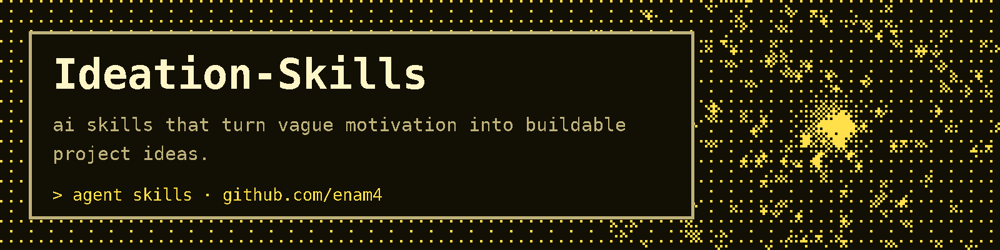
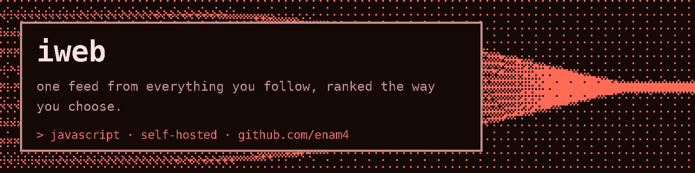

## ░ interpretability experiments

Five small experiments on Qwen2.5 (0.5B and 1.5B), each run end to end on a CPU, with controls, raw outputs and the code to rebuild every chart.

<a href="https://github.com/enam4/qwen-vector-steering"></a>
<a href="https://github.com/enam4/sycophancy-probe"></a>
<a href="https://github.com/enam4/qwen-glitch-tokens"></a>
<a href="https://github.com/enam4/persona-mixing-steering"></a>
<a href="https://github.com/enam4/emergent-misalignment-small-scale"></a>

```text
┌────────────────────────┬───────────────────────────────────────────────┐
│ project                │ what it found                                 │
├────────────────────────┼───────────────────────────────────────────────┤
│ qwen-vector-steering   │ one "grumpy" direction shifts a 0.5B model's  │
│ (amber)                │ persona at 0.5x; past 1x it loops             │
│ sycophancy-probe       │ 91% of caved answers still read false to a    │
│ (cyan)                 │ linear truth probe                            │
│ qwen-glitch-tokens     │ ~1,900 blank-embedding tokens; 200/200 fail   │
│ (magenta)              │ a repeat test vs 11-27% of controls           │
│ persona-mixing-        │ two persona vectors at once make new          │
│ steering (violet)      │ characters and miss 2+2 more often            │
│ emergent-misalignment- │ insecure-code lora broke coherence first;     │
│ small-scale (green)    │ inconclusive at 0.5B                          │
└────────────────────────┴───────────────────────────────────────────────┘
```

## ░ tools and agent skills

<a href="https://github.com/enam4/Ideation-Skills"></a>
<a href="https://github.com/enam4/KBsearch"></a>
<a href="https://github.com/enam4/iweb"></a>
<a href="https://github.com/enam4/FileTree"></a>
